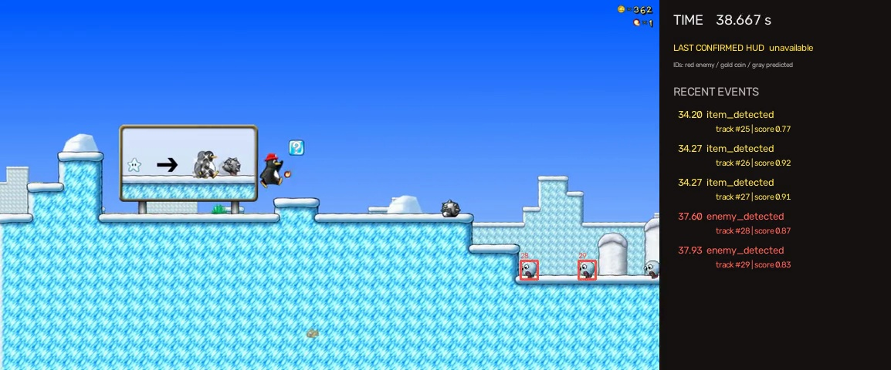

# Gameplay video → structured events

An offline Python computer-vision pipeline for **SuperTux v0.6.3**. It detects enemies and coins from video pixels, associates detections across frames, and exports timestamped events with confidence and supporting evidence. The submission includes a held-out gameplay demo, JSON/CSV outputs, evaluation annotations, metrics, and tests.

[Download the complete submission](https://github.com/XiaoSong1223/supertux-gameplay-event-detection/releases/tag/v0.1.0) · [Download the 90-second demo](https://github.com/XiaoSong1223/supertux-gameplay-event-detection/releases/download/v0.1.0/evaluation-demo.mp4) · [Read the evaluation](docs/EVALUATION.md)



## Start here

1. Watch [`outputs/evaluation/demo.mp4`](outputs/evaluation/demo.mp4), a 90-second annotated recording with track IDs and an event feed.
2. Inspect [`outputs/evaluation/events.json`](outputs/evaluation/events.json) or [`events.csv`](outputs/evaluation/events.csv).
3. Read [`docs/EVALUATION.md`](docs/EVALUATION.md) for measured results, failure cases, and evaluation scope.

The input interval is **[2, 92) seconds** of the original recording. Output video starts at that source interval; overlay and event timestamps remain absolute source-video time. The demo has no audio.

Box labels are track IDs; colors identify enemies, coins, and temporarily predicted tracks. The HUD panel shows the **last confirmed** read, which may be stale when the reader abstains. Event scores and complete evidence remain available in JSON/CSV.

Measured detection F1 is **88.3%** on 40 fixed held-out frames. The tracking/event diagnostics are limited to predefined short windows, and the experimental HUD reader has **0/40 held-out read coverage**. The evaluation report includes these failures and the smoothing tradeoff.

## Reproduce

Tested on **CPython 3.12, macOS Apple M4, 16 GB RAM**, with CPU inference. Use an editable install from this extracted source directory so the bundled asset paths resolve correctly. A standalone wheel without the sibling asset directory is not a supported distribution.

```bash
git clone https://github.com/XiaoSong1223/supertux-gameplay-event-detection.git
cd supertux-gameplay-event-detection

python3.12 -m venv .venv
source .venv/bin/activate
python -m pip install -r requirements-lock.txt
python -m pip install -e . --no-deps
python -m pytest -q

# Download the two public source videos and verify pinned file checksums.
# Templates and the small HUD model are already included in the submission.
python scripts/fetch_assets.py

python -m gameplay_events \
  --video data/videos/evaluation.webm \
  --output outputs/reproduction \
  --start 2 --end 92 --fps 15 --workers 4
```

An initial two-second smoke run can use `--start 5 --end 7`. The pinned dependencies are the tested environment; the broader requirements in `pyproject.toml` are not a claim that every version/platform was tested. `imageio-ffmpeg` supplies the video encoder on the tested platform, so no separate system FFmpeg installation was needed. Original videos are omitted from the ZIP to keep the submission small; public URLs and SHA-256 hashes are in [`data/sources.json`](data/sources.json).

The detector is an **offline baseline**, not a real-time system. `--workers` parallelizes frame detection while tracking/event updates remain in temporal order. `--no-video` skips MP4 encoding. The requested analysis rate must exactly divide the source frame rate; the supplied recordings are 60 fps and are analyzed at 15 fps.

## Approach and design choices

### 1. Detection

OpenCV masked template matching recognizes two semantic labels: `enemy` and `coin`. Templates come from the public, version-pinned SuperTux sprite assets. Supported enemy appearances include snowballs, smartballs, ice blocks, jumpies, spikies, bombs, and flying snowballs, with selected animation and transformed states.

Frames are normalized to width 854. Coarse grayscale correlation proposes locations; full-resolution masked correlation and color agreement verify them. A gold-color proposal path helps with small coins, including narrow edge-on animation frames. Class-aware suppression removes duplicate matches. The upper HUD region is excluded from world-object detection.

This choice fits a short assignment with a small, fixed visual domain and no supplied training set. It exposes the evidence behind each detection and requires no neural detector training. It also creates a clear tradeoff: a new game, sprite style, zoom, or unsupported animation needs new templates or a learned detector. It is not intended as a game-agnostic recognizer.

### 2. Camera-aware tracking

Background feature flow estimates frame-to-frame camera translation using a robust median. A class-aware assignment tracker combines predicted motion and spatial gating to associate objects despite scrolling. Tracks survive a short detection gap of 0.35 seconds. Scene-cut detection clears temporal state; IDs are not reused within a run.

IDs describe **visibility episodes**. They do not establish persistent engine identity after a long occlusion or after an object leaves the screen. The track log distinguishes observed boxes from predicted boxes during a temporary miss. Event confirmation uses observed evidence only.

### 3. Temporal event rules

| Event | Evidence | Confirmation |
|---|---|---|
| `enemy_detected` | A tracked enemy becomes visible | Three consecutive observed analysis frames |
| `item_detected` | A tracked world coin becomes visible | Three consecutive observed analysis frames |
| `enemy_disappeared` | A previously confirmed enemy stops being observed | Absence persists for at least 0.35 seconds |
| `coin_count_changed` | The HUD reader accepts a new counter value | Three consistent reads spanning at least 0.08 seconds |

Appearance/disappearance timestamps refer to the first supporting/missing sampled frame and may be emitted later. `confirmed_at` makes that delay explicit. At 15 fps, three consecutive appearance observations span about 0.133 seconds. Actual latency also includes detection misses and sample alignment. End of video does not produce disappearance events.

A disappearance is a visibility event. It does not prove a kill or identify a pickup. `item_detected` means the coin became visible, including a recognizable reward animation. HUD deltas may aggregate several count changes if intermediate digits were unreadable; no coin-to-HUD identity association is claimed.

### 4. Optional HUD reading

The four fixed digit slots are read by a small **ridge classifier** trained on 280 labeled digit/background patches from the development clip only. Low-margin or partial reads are rejected. The checked-in NumPy model is about 13 KB. This is a supervised OCR component, separate from the template detector. See [`docs/HUD_NOTES.md`](docs/HUD_NOTES.md) for geometry, training labels, and limitations.

## Output contract

Each run creates:

| File | Contents |
|---|---|
| `events.json`, `events.csv` | Confirmed events and supporting evidence |
| `raw_detections.jsonl` | Metadata header plus frame-level detections; reusable cache |
| `tracks.jsonl` | Track IDs, observed/predicted state, camera shifts, scene-cut flags |
| `run.json` | Source/configuration hashes, parameters, frame count, event counts, timing |
| `demo.mp4` | Annotated frames and event feed, unless `--no-video` is used |

For example, the event schema is:

```json
{
  "timestamp": 6.0,
  "event": "enemy_detected",
  "confidence": 0.91,
  "confirmed_at": 6.1333333333,
  "track_id": 12,
  "evidence": {
    "label": "enemy",
    "consecutive_observations": 3,
    "confidence_note": "uncalibrated heuristic score"
  }
}
```

This schema example is illustrative; measured events are in the linked output files. Bounding boxes use `[x1, y1, x2, y2]` in the processed 854×480 gameplay image. All times are seconds from the source video. JSON events are written in confirmation order, so backdated `timestamp` values need not be strictly sorted. CSV preserves structured `evidence` as a JSON string.

Confidence is an **uncalibrated evidence score**, not a probability of correctness. Detector confidence combines correlation and color agreement. Object-event confidence copies the latest supporting detection score; disappearance confidence is not an independently calibrated probability that an object disappeared. HUD confidence reflects classifier separation on development data.

## Evaluation and reproducibility

- Development: *Welcome to Antarctica*. Held-out level: *The Journey Begins*, from the same recorder/version/resolution. The clips were screened for suitability before development, so this is a held-out implementation evaluation within one visual domain, not a fully unseen game benchmark.
- Detection: 40 preselected frames, all visible enemies/coins boxed, class-aware one-to-one IoU ≥ 0.5 matching. These exact source frames are scored, including frames between the regular 15 fps samples.
- Tracking and event diagnostics: predefined short temporal windows; exact executed scope and exclusions are in the evaluation report.
- HUD: separate visual labels at the same 40 fixed timestamps. Coverage and accepted-read accuracy are reported separately.
- Labels are **AI-assisted visual annotations without an independent human audit**. No human-labeled accuracy claim is made.

Core detector/tracker/event/HUD files were frozen before held-out inference, with hashes in [`data/freeze.json`](data/freeze.json). The annotation information barrier and the difference between the planned and executed protocol are documented in [`docs/ANNOTATION_PROTOCOL.md`](docs/ANNOTATION_PROTOCOL.md). Pipeline robustness changes do not tune detection parameters.

```bash
# Re-run exact-frame detection evaluation; checks frozen core file hashes first.
python scripts/score_detection.py --workers 2

# Score the included tracks/events on the actual annotated temporal windows.
python scripts/score_temporal.py

# Replay the same raw detections with object-event smoothing disabled.
# The tracker and HUD stabilization remain the same for this ablation.
python -m gameplay_events \
  --video data/videos/evaluation.webm \
  --output outputs/evaluation_no_smoothing \
  --cache outputs/evaluation/raw_detections.jsonl \
  --start 2 --end 92 --fps 15 --no-smoothing --no-video
```

Raw caches are validated against video/configuration/detector hashes and sampling parameters. They are not a substitute for fresh-video inference. The submission preserves the original predictions and includes the annotation files needed to recompute reported metrics.

## Limitations and next steps

Small sprites, edge truncation, partial occlusion, compressed animation frames, and unsupported defeat states can cause missed detections. Parallax or non-translational camera motion can impair camera compensation. Spatial association can exchange IDs among nearby same-class objects. Detection flicker can split visibility episodes and create duplicate events; temporal smoothing reduces some flicker while delaying or missing very short events.

The HUD has a fixed layout and tiny glyphs. Abstention can yield delayed or aggregated counter updates. Its validation set is small and uses the same visual domain as training. The current evaluation does not establish full-video identity accuracy, generalization to different recordings, or real-time throughput.

Given more time, the next priorities would be independently reviewed annotations on more recordings, explicit occlusion/re-identification handling, more scale/animation coverage or a compact trained detector, and calibrated event confidence. The measured error cases in the evaluation report determine which improvement to prioritize.

## Code map and sources

`src/gameplay_events/` separates detection, camera motion, tracking, event rules, HUD reading, evaluation, and the ordered pipeline. `tests/` covers temporal edge cases, association, metric matching, cache validation, and end-to-end output behavior. `scripts/` contains data fetching, reproducible model/configuration builders, sampling, and evaluation entry points.

Recordings are by **PantheraLeo1359531** on Wikimedia Commons. Sprites/fonts are from **SuperTux v0.6.3**. Source links, hashes, upstream license text, and attribution are preserved in [`THIRD_PARTY_NOTICES.md`](THIRD_PARTY_NOTICES.md) and [`data/sources.json`](data/sources.json).

AI coding and analysis tools assisted implementation, documentation, and the explicitly identified visual annotations. The source, tests, saved predictions, and provenance are provided for review.
