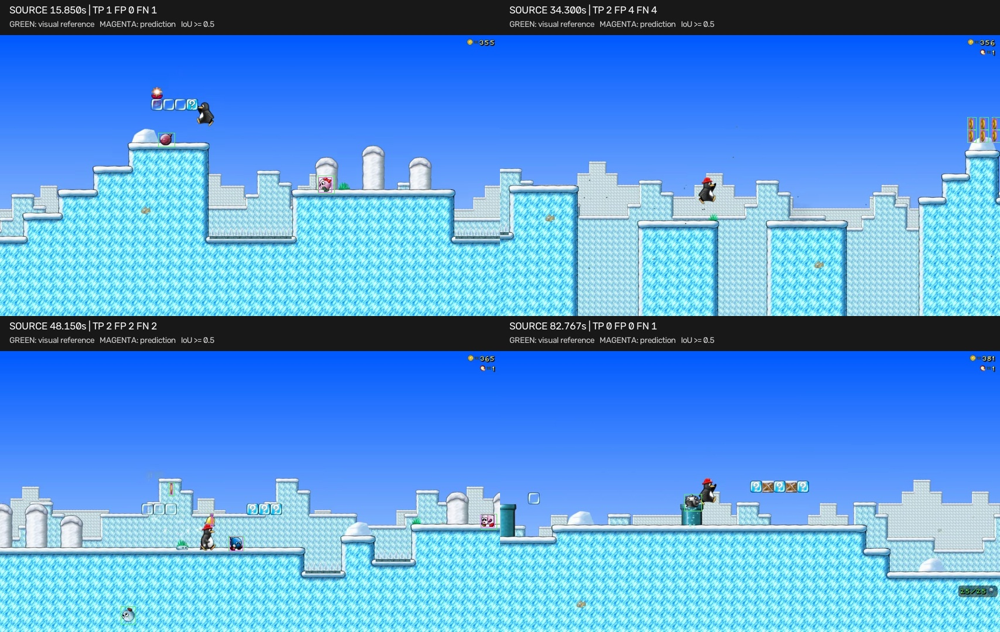

# Evaluation report

The frozen detector achieves **90.7% precision, 86.0% recall, and 88.3% F1** on 40 fixed frames from the held-out level. Tracking and events work end to end, with measurable misses and identity fragmentation. The experimental HUD reader fails to generalize to this recording and is not presented as a successful held-out bonus.

All reference labels are **AI-assisted visual annotations without an independent human audit**. These are small, within-domain diagnostics rather than a broad benchmark.

## Data and separation

Development uses *Welcome to Antarctica*; evaluation uses *The Journey Begins*. Both recordings are by PantheraLeo1359531, show SuperTux v0.6.3, and use the same 854×480 / 60 fps transcode domain. They were screened for suitability before development. Inference uses pixels only, with no game-engine state or frame-to-event lookup table.

Core detector, tracker, event, camera, and HUD file hashes were saved in `data/freeze.json` before held-out inference. Detection parameters were selected on development data only. An isolated annotator prepared raw-video labels without viewing predictions. Annotation began before the implementation owner declared the freeze, but its contents were withheld from that owner; the exception is recorded in `ANNOTATION_PROTOCOL.md`.

One configuration record discrepancy was discovered during packaging: the original freeze summary listed tracker `confirmation_hits=2`, while the pipeline used `1` from its initial smoke/full runs. The actual value is now explicitly recorded in the freeze addendum. Object-event confirmation remained three observed frames. No frozen algorithm file or threshold was changed in response to held-out results.

## Detection: 40 fixed frames

The schedule is `2 + i × 90/39` seconds, for `i=0..39`, rounded to the nearest source frame. Every frame is retained, including six empty frames. The final sample at 92.0 seconds belongs to this endpoint-inclusive detection schedule; full-video inference uses the half-open interval `[2,92)`.

All recognizable world enemies and coins are labeled, including partial, transformed, and short reward-animation appearances. HUD icons, sign illustrations, and player projectiles are excluded. Matching is class-aware, one-to-one, and requires IoU ≥ 0.5. The assignment maximizes valid pair count before total IoU.

| Class | Reference objects | TP | FP | FN | Precision | Recall | F1 |
|---|---:|---:|---:|---:|---:|---:|---:|
| Enemy | 57 | 49 | 3 | 8 | 94.2% | 86.0% | 89.9% |
| Coin | 57 | 49 | 7 | 8 | 87.5% | 86.0% | 86.7% |
| Micro total | 114 | 98 | 10 | 16 | 90.7% | 86.0% | 88.3% |

There were 108 predictions and no ignored predictions. A separate post-evaluation AI visual audit reviewed all 40 raw frames and ground-truth-only overlays without opening predictions or metrics; it found no detection-label corrections. The original ground truth and first prediction file remain unchanged. See `ANNOTATION_AUDIT.md`.

These numbers are a single operating point, not mAP. The 114 objects are temporally correlated observations, not 114 independent recordings.

## Tracking: three short segments

The predefined windows are `[8,11)`, `[38,41)`, and `[68,71)` seconds. The completed reference contains **45 frames at 5 fps**, 120 object observations, and 18 visibility-episode IDs. This is a reduction from the originally planned 15 fps annotation cadence and is reported explicitly.

| Measure | Result |
|---|---:|
| Matched observations, IoU ≥ 0.5 | 85 / 120 |
| Observation recall | 70.8% |
| Identity switches | 3 |
| Fragments | 6 |

The tracker still runs at 15 fps; scoring samples it at the annotated 5 fps timestamps. Observed boxes and temporarily predicted boxes are both eligible. A switch compares consecutive matched IDs, including across a miss. A fragment is an additional matched run after a miss.

These counts do not establish full-video MOT accuracy. Five-fps annotation can miss short gaps/switches, and overlapping coin identities in the third segment have greater reference uncertainty. Detection misses and tight spatial association can interrupt or split episodes even when a later frame is detected correctly.

## Events and smoothing ablation

The completed event reference covers the **three preselected two-second interiors** `[8.5,10.5)`, `[38.5,40.5)`, and `[68.5,70.5)`. Half-second edge exclusions avoid unobserved prehistory and right-edge censoring. There are eight visual reference events. Boundaries come from 5 fps raw-frame review and have up to 0.2 seconds sampling uncertainty.

This limited reference replaces the originally planned full 90-second event annotation. A full independent timeline was not completed; **no full-video event precision or recall is claimed**. The full 90-second run and its complete output events are still included.

Matching is one-to-one by event type and absolute timestamp error ≤ 0.5 seconds. It does not verify event-to-object identity. Both ablation variants use identical saved raw detections and the same tracker; only object-event confirmation/grace changes. HUD stabilization remains enabled in both.

| Smoothed event type | References | TP | FP | FN | Precision | Recall |
|---|---:|---:|---:|---:|---:|---:|
| `enemy_detected` | 4 | 4 | 0 | 0 | 100% | 100% |
| `enemy_disappeared` | 1 | 0 | 0 | 1 | Undefined | 0% |
| `item_detected` | 3 | 2 | 0 | 1 | 100% | 66.7% |
| Total | 8 | 6 | 0 | 2 | 100% | 75.0% |

| Variant | TP / FP / FN | Precision | Recall | F1 | Mean matched timestamp error | Mean matched confirmation latency |
|---|---|---:|---:|---:|---:|---:|
| Smoothing on | 6 / 0 / 2 | 100% | 75.0% | 85.7% | 0.089 s | 0.133 s |
| Smoothing off | 7 / 0 / 1 | 100% | 87.5% | 93.3% | 0.095 s | 0.019 s |

The small reference **does not show an accuracy improvement from smoothing**: the confirmation requirement misses one short item event. No disappearance is matched in either variant. Perfect precision here describes only six/seven predicted events in six seconds and should not be generalized. Timing figures are descriptive and limited by the coarser reference cadence.

Across the complete 90-second evaluation run, smoothing changes output counts as follows:

| Event | Smoothing on | Smoothing off |
|---|---:|---:|
| `enemy_detected` | 42 | 49 |
| `enemy_disappeared` | 42 | 49 |
| `item_detected` | 36 | 48 |
| Total | 120 | 146 |

Lower counts alone do not prove fewer false positives: smoothing can suppress flicker and real short events. The original default remains frozen; it was not changed to maximize held-out scores.

## Experimental HUD result

At the same 40 fixed held-out timestamps, all counters were visually readable but the frozen OCR accepted **0/40**. Coverage is **0%**; accepted-read exact accuracy is **undefined**. Zero wrong accepted reads is not evidence of correctness. The complete held-out run also produced no `coin_count_changed` events.

The development run produced 10 counter-change events, but the small ridge head was trained on development-video patches, so this is only a functionality demonstration. It is not held-out accuracy. Post-hoc crops show the same digit-slot geometry but low/wrong-class margins in the evaluation clip, consistent with poor pixel/background generalization. See `HUD_EVALUATION.md` for the diagnostic and original/audited results.

A post-evaluation visual audit corrected one HUD reference at source frame 2889 from 363 to 365. The other 39 labels were unchanged; original files are retained and audited files are separate. Because every read was rejected, the measured result is unchanged. No model or threshold was updated.

## Observed failure examples



Green boxes are visual references; magenta boxes are predictions. These panels were chosen after scoring to illustrate errors, not to define the test set.

- **15.850 s:** a transformed/rolling enemy appearance is missed while the other visible enemy is detected.
- **34.300 s:** narrow coin animation frames near the right edge produce boxes that fail the IoU threshold; four instances contribute both FP and FN despite approximate localization.
- **48.150 s:** a visible defeated/falling enemy is missed, and thin coin/reward-like appearances produce detection errors.
- **82.767 s:** a spiky enemy near the player is missed. Small appearance changes/occlusion remain difficult for the fixed template bank.

Full per-frame results are preserved in `outputs/review/detection_frame_metrics.json`. The image review did not trigger algorithm tuning.

## Runtime and checks

Each full run processes 1,350 frames and writes a 90-second, 15 fps, 1154×480 annotated MP4. The extra 300-pixel width is an event panel; detection coordinates refer only to the 854×480 gameplay area. Both runs report zero scene cuts.

| Run | Analysis wall time | Analysis frames / wall second |
|---|---:|---:|
| Development, detection + video | 750.7 s | 1.80 |
| Evaluation, detection + video | 506.9 s | 2.66 |
| Evaluation cached ablation, no video | 18.6 s | 72.63 |

The full runs overlapped on an Apple M4 with four detector workers each; these are recorded execution times under contention, not controlled throughput benchmarks. The cached ablation skips expensive detection and is not a fresh-video speed claim. This implementation is offline and does not meet real-time 15 fps inference.

The final demos were subsequently re-rendered from saved tracks/events to improve label readability and mark the HUD as the last confirmed value. The table measures the initial analysis runs; it excludes this presentation-only re-render. Predictions and metric inputs are unchanged.

The test suite has **52 passing tests**, covering matching, identity behavior, temporary loss, scene cuts, event confirmation, EOF semantics, HUD stabilization, exact sampling, cache validation, and truncated decode handling. Tiny synthetic pipeline tests deliberately trigger five warnings about non-calibrated frame height.

## Recompute the reported metrics

From the installed source checkout, after fetching videos:

```bash
python scripts/score_detection.py --workers 2
python scripts/score_temporal.py
python scripts/evaluate_hud.py
python scripts/evaluate_hud.py \
  --annotations data/annotations/hud_evaluation_audited.json \
  --output outputs/metrics/hud_audited.json
python scripts/render_detection_review.py
```

`score_temporal.py` reads the included full-run tracks/events and cached ablation events, filters to the exact annotation scope, and writes `outputs/metrics/tracking.json` and `events.json`. To regenerate its inputs, follow the fresh inference and cache-ablation commands in the README. Core hashes, source hashes, raw predictions, original annotations, and the HUD correction history are included.

The next evaluation priority is a larger, independently reviewed event timeline and additional recordings. The present evidence supports a reproducible narrow-domain baseline and identifies concrete limitations; it does not establish production readiness or general game understanding.
